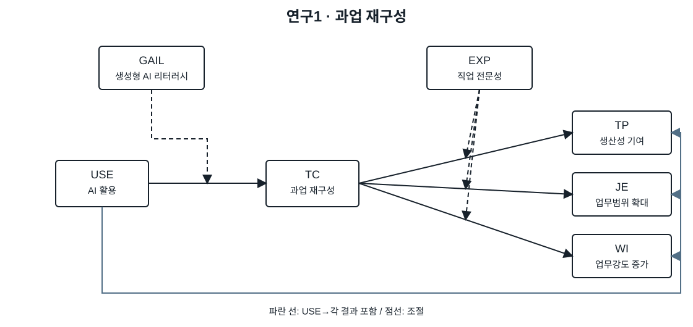
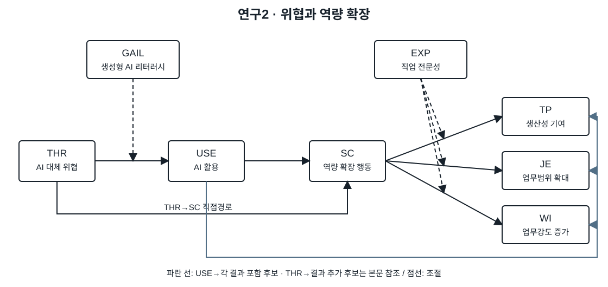

::: {.page .background-page}

[연구계획서 v0.96 · 핵심 요약 / 01]{.small}

# 연구의 출발점과 핵심 질문

생성형 AI의 업무 수행 지원은 디자이너가 맡는 일의 범위와 강도, 그리고 필요한 역량을 어떻게 변화시키는가?

## 1. AI의 업무 지원과 디자이너의 업무 변화

생성형 AI는 이미지와 문구의 초안을 만들고, 자료를 탐색하거나 결과물을 수정하는 등 디자이너의 업무 수행을 지원한다. 이러한 지원이 디자이너의 일에 어떤 변화를 가져오는지가 본 연구의 출발점이다. 기존 업무를 수월하게 수행하는 데 그치는지, 담당하는 업무의 범위와 강도, 필요한 역량까지 달라지는지 살펴보고자 한다.

현업 디자이너 6명을 대상으로 한 사전인터뷰에서는 AI의 생산성 기여와 함께 일이 다양해지거나 많아졌다는 경험이 제기됐다. 기존에 다른 전문영역에서 담당하던 일을 AI의 도움으로 맡고, 달라진 도구와 작업방법에 대응해야 한다는 것이다. 이는 AI가 수행을 지원하는 것과 디자이너가 맡아야 할 일이 줄어드는 것이 같은 변화는 아닐 수 있음을 보여주는 문제의식이다.

본 연구는 이러한 경험이 다양한 경력의 디자이너에게 어떻게 나타나는지 확인하고자 한다.

## 2. 업무 변화와 역량 변화로 나누어 살펴볼 필요성

이 변화를 이해하려면 맡는 일을 어떻게 바꾸는지와 그 일을 위해 어떤 역량을 넓히려 하는지를 구분할 필요가 있다. AI를 활용해 새로운 과업을 시도하는 행동과 새로운 기술·학습 기회를 탐색하는 행동은 함께 나타날 수 있지만, 서로 다른 변화에 초점을 둔다.

Bindl et al.(2019)의 과업 크래프팅(TC)과 스킬 크래프팅(SC)은 이 두 행동을 구분할 개념적 근거를 제공한다. Hou et al.(2025)이 디자인 단계와 전문성에 따른 AI 활용 결과의 차이를 제시한 점도, 업무 지원의 결과를 개인의 전문성과 함께 살펴볼 이유가 된다.

이에 연구1은 AI 활용과 과업 재구성의 관계를 살펴본다. 연구2는 대체 위협 인식·AI 활용과 역량 재구성의 관계를 살펴본다. 연구2에 위협 인식을 포함한 이유는 인터뷰에서 업무와 도구의 변화뿐 아니라, AI로 인한 일자리 대체에 대한 걱정도 제기됐기 때문이다. 각 연구는 해당 행동이 생산성 기여, 업무범위 확대, 업무강도 증가와 어떻게 관련되는지 검토한다.

::: folio
박진현 · 생성형 AI와 디자이너의 과업·역량 재구성　1 / 3
:::

:::

::: {.page .model-page}

[연구계획서 v0.96 · 핵심 요약 / 02]{.small}

# 연구1과 연구2의 모형

<figure>

<figcaption>연구1 · 과업 재구성 — AI 활용과 과업을 바꾸는 행동의 관련성</figcaption>
</figure>

TC는 맡는 과업을 능동적으로 바꾸고 도전적인 과업을 시도하는 행동이다. **GAIL은 USE--TC**, **EXP는 TC--TP·JE·WI**의 관계를 조절하는지 검토한다. USE→각 결과 직접경로를 포함한다.

<figure>

<figcaption>연구2 · 역량 재구성 — 대체 위협·AI 활용·역량 탐색 행동의 관련성</figcaption>
</figure>

SC는 새로운 기술과 학습 기회를 탐색하는 행동이다. **GAIL은 THR--USE**, **EXP는 SC--TP·JE·WI**의 관계를 조절하는지 검토한다. THR→SC 직접경로를 유지한다.

점선은 조절 관계다. 연구2의 USE→각 결과는 작업용 후보 사양이며, THR→각 결과 추가는 민감도 검토 대상이다. 최종 주 분석 사양은 자료 수집 전에 확정한다.

::: folio
박진현 · 생성형 AI와 디자이너의 과업·역량 재구성　2 / 3
:::

:::

::: {.page}

[연구계획서 v0.96 · 핵심 요약 / 03]{.small}

# 연구별 측정·분석과 기여

## 연구1 · 과업 재구성

**측정.** USE 4문항, TC 4문항, TP 3문항, JE 3문항, WI 5문항, GAIL 17문항, EXP 5문항을 사용한다. TC는 지난 1주의 행동을, JE·WI는 최초 업무상 AI 사용 전 대비 경험을 묻는다.

**분석.** 세 결과의 분포와 TC--JE 판별성을 확인한다. USE→TC→각 결과 및 USE의 직접 관련성을 분석한다. GAIL은 USE--TC, EXP는 TC--세 결과 관계를 조절하는지 검토한다.

**기여.** 과업을 능동적으로 바꾸는 행동이 생산성 기여와 담당 업무의 범위·강도에 어떤 관련성을 갖는지 설명한다.

## 연구2 · 위협과 역량 재구성

**측정.** THR 4문항, USE 4문항, SC 4문항, TP 3문항, JE 3문항, WI 5문항, GAIL 17문항, EXP 5문항을 사용한다. SC는 지난 1주의 역량 탐색 행동이며 실제 숙련 향상과 구분한다.

**분석.** THR→USE→SC, THR→SC, SC→각 결과를 검토한다. GAIL은 THR--USE, EXP는 SC--세 결과 관계를 조절하는지 살핀다. 결과 직접경로의 주 사양은 조사 전에 확정한다.

**기여.** 대체 위협·AI 활용·역량 탐색의 관련성과, 전문성에 따른 업무 결과의 차이를 설명한다.

## 조사 운영

동일 설문의 두 분석이며 공유 문항은 한 번만 묻는다. 핵심 49문항, 전체 73문항이다. ACT1\~4·자발적/부과된 확대·경력은 보조정보다. END_DIFF는 WI·EXP와의 관련성을 탐색하는 미검증 단일 보조문항이다. 모집·표본수·추정법은 확정 과제다.

## 결론에서의 통합 논의

각 연구 결과를 제시한 뒤, 사전에 계획한 보완 분석으로 동일 응답자의 TC·SC와 세 결과의 고유 관련성을 비교한다. 생산성 기여와 업무 부담이 공존하는 경우와 강도 증가가 작은 경우를 함께 논의한다. 분석 결과는 변수 간 관련성으로 해석하며, 인과관계로 단정하지 않는다.

문항 출처: TC·SC---Bindl et al.(2019); USE---X. Zhang et al.(2026); TP---Torkzadeh와 Doll(1999); WI---Kubicek et al.(2015); GAIL---Liu et al.(2025); EXP---Van der Heijden et al.(2018); THR---Brougham과 Haar(2018). JE는 연구자 개발이다. [전체 참고문헌](09_APA참고문헌·원문_v0.96.html)

::: folio
박진현 · 생성형 AI와 디자이너의 과업·역량 재구성　3 / 3
:::

:::
